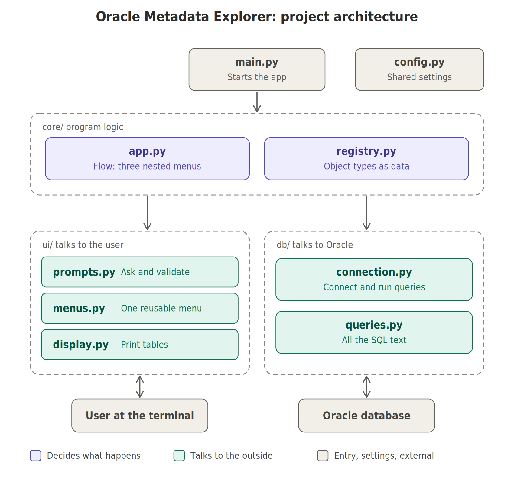
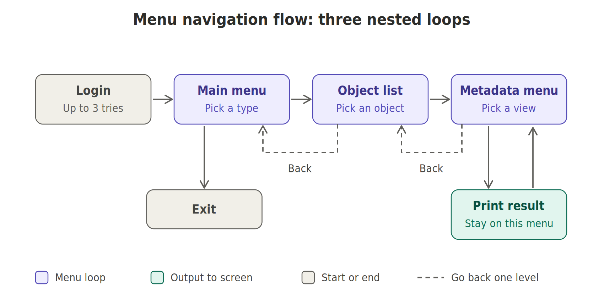
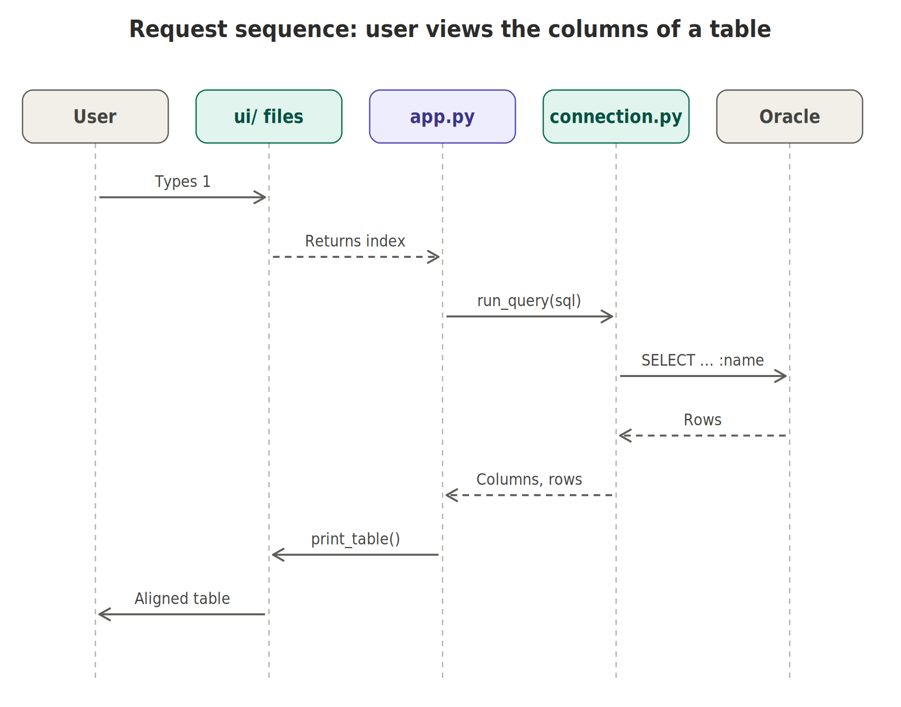

# Oracle Metadata Explorer

A terminal app, written in Python with `python-oracledb`, that connects to an
Oracle Database and lets you explore its metadata interactively, like a
simple SQL Developer in the console.

## Features

- Log in with username, password and service name
- Browse tables, views, sequences, constraints and users
- View columns, constraints, indexes, view definitions and more
- Menu navigation with Back and Exit at every level

## Requirements

- Python 3.9 or newer
- A running Oracle Database you can log in to (for example the `HR` schema)
- Basic terminal knowledge (running commands, using `venv`)

## Setup

```bash
git clone https://github.com/0xMotazMohamed/terminal-oracle-metadata-explorer.git
cd oracle-metadata-explorer
python3 -m venv .venv
.venv/bin/python -m pip install -r requirements.txt
```

## Run

```bash
./run.sh
```

Or manually:

```bash
source .venv/bin/activate
python3 main.py
```

## Example

```
Welcome to Oracle Metadata Explorer!
Enter username: HR
Enter password:
Enter service name [orcl]:

Select the object type you want to view:
1. Tables
2. Views
3. Sequences
4. Constraints
5. Users
6. Exit
Enter option number: 1
```

Then pick an object by number and choose what to view (columns, constraints,
indexes, and so on).

## How it works

Three layers: `core/` decides, `ui/` talks to the user, `db/` talks to Oracle.







## Project structure

```
main.py          entry point
config.py        settings
core/            program flow and object-type registry
db/              connection and SQL queries
ui/              prompts, menus and table display
docs/images/     diagrams
```

## Add a new object type

1. Add its SQL to `db/queries.py`
2. Add one entry to `OBJECT_TYPES` in `core/registry.py`

The menus update automatically.